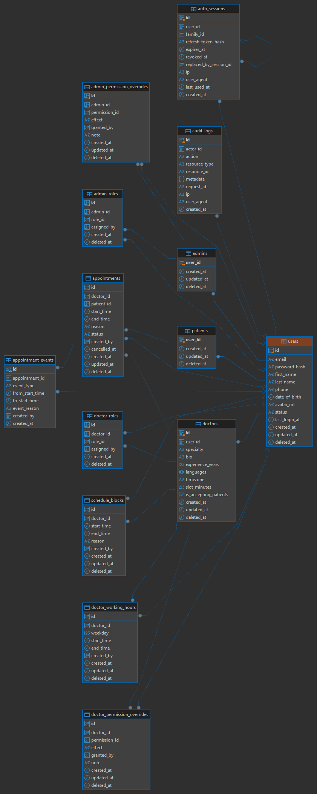

# CuraClinic

A full-stack clinic scheduling platform: a **React 19 / Vite** web app in front of a **Go 1.27 / Gin** API, backed by **PostgreSQL 18** and **Redis**. It serves three kinds of users (patients, doctors and clinic administrators), and each one gets a portal shaped by role-based access control.

> **Live demo:** `https://curaclinic.chama360.com/`
> **Admin Email:** 'admin@example.com'
> **Doctor Email:** ' johndoc@email.com'
> **Patient Email:** 'jonpatient@gmail.com'
> **Password(for all):** 'Pa$$w01234rd!'

---

## Table of contents

1. [What the app does](#what-the-app-does)
   - [Patients](#patients)
   - [Doctors](#doctors)
   - [Administrators](#administrators)
   - [Shared across every role](#shared-across-every-role)
2. [Architecture](#architecture)
3. [Booking engine: Redis holds + PostgreSQL guarantees](#booking-engine-redis-holds--postgresql-guarantees)
4. [Backend engineering highlights](#backend-engineering-highlights)
5. [Database design](#database-design)
6. [API overview](#api-overview)
7. [Error handling and validation](#error-handling-and-validation)
8. [Running locally](#running-locally)
9. [Testing](#testing)
10. [CI/CD pipeline](#cicd-pipeline)
11. [Deployment](#deployment)
12. [AI usage notes](#ai-usage-notes)

---

## What the app does

Everyone signs in at `/login`, and the app sends each user to their own home based on their roles and effective permissions:

| User | Lands on | Portal |
|---|---|---|
| Patient | `/` | Patient portal |
| Doctor | `/daily-agenda` | Clinician workspace |
| Admin / front-desk staff | `/admin` | Clinic administration |

Sidebars, routes and action buttons are **permission-aware**. A user only sees the sections their effective permissions allow, so a front-desk role with a narrower permission set gets a smaller admin area automatically.

### Patients

- **Self-registration** at `/signup` creates a patient account and signs the user in straight away.
- **Dashboard.** Shows the next upcoming appointment, an appointment summary and recent visits, all loaded live from the API.
- **Browse doctors.** Lists every doctor accepting patients with specialty, bio, years of experience, languages and slot length.
- **See real-time availability per doctor.** Pick a doctor and a date to get that doctor's open slots. Slots are computed on the fly from the doctor's weekly working hours, minus schedule blocks (leave, lunch, etc.), minus confirmed appointments, minus slots that other patients are holding at that moment.
- **Book an appointment** with a guided, step-by-step flow (doctor → date and time → visit details → review):
  - Choosing a slot places a **temporary Redis hold** on it, so no other patient can take it while this patient finishes the form.
  - A **live countdown** shows how long the hold lasts. If it expires, the user is told and asked to choose again.
  - The patient adds a reason for the visit and confirms.
- **Reschedule.** Choose a new time for an upcoming appointment. The same availability and hold rules apply, and the change is recorded in the appointment's history.
- **Cancel.** Cancel with a reason. The slot goes back to the clinic **immediately**, so other patients can book it.
- **My appointments.** Tabs for upcoming, past and cancelled visits.
- **Settings.** Edit profile details (name, phone, date of birth, avatar) and change password. Changing the password signs the user out of every device.

### Doctors

- **Daily agenda.** A day-by-day list of booked appointments with patient details, visit reason and status (confirmed/cancelled), with previous/next-day navigation.
- **Week calendar.** A weekly view of booked visits and blocked time.
- **Manage booked appointments.** Cancel a visit with a reason, or reschedule it for the patient.
- **Book for a patient.** Doctors with the permission can book a slot on a patient's behalf.
- **Schedule & availability.**
  - Define recurring **weekly working hours** (several intervals per weekday).
  - **Block time** for lunch, leave or other commitments. Overlapping blocks are rejected.
  - Remove blocks. Changes show up in patient-facing availability straight away.
- **Practice profile.** Specialty, bio, experience, languages, timezone, slot size, and whether the doctor is accepting new patients.

### Administrators

- **Clinic overview dashboard.** A live snapshot of patients, doctors and today's diary, plus the next five confirmed visits.
- **Appointments.** The whole clinic diary, filterable by date, doctor and status. Admins can cancel with a reason, reschedule, or **book manually** for any patient. Manual bookings skip the hold step, but every booking rule and database constraint still applies.
- **Doctors.** Create doctor accounts and edit clinician profiles and the public directory.
- **Schedule management.** Manage working hours and blocked time for **any** doctor.
- **Patients & users.** Search by name or email, filter by role, and activate or deactivate accounts. Deactivation takes effect on the user's next request.
- **RBAC management (Roles & permissions):**
  - Create, edit, duplicate and delete roles, each with an **admin** or **doctor** scope.
  - Toggle a role's permissions from a catalogue of granular permission codes (for example `appointments.view_any`, `admin.roles.manage`), with an unsaved-changes guard.
  - Assign roles to users.
  - Add **per-user permission overrides** (`allow` or `deny`, with an optional note). **Deny always wins** over role grants and allow overrides.
  - System roles cannot be deleted, and the **last active admin** cannot be demoted or deactivated.
- **Audit trail.** Every sensitive mutation (bookings, cancellations, role and permission changes, user changes) is written to `audit_logs` with actor, resource, request ID, IP and user agent.

### Shared across every role

- **Session handling.** A short-lived access token plus a rotating refresh token, refreshed silently in the background.
- **Single-flight, cross-tab refresh.** Refreshes run under the Web Locks API, so several open tabs never present the same refresh token twice. Presenting a used refresh token counts as theft and revokes the whole session.
- **Idle timeout.** After 30 minutes of inactivity (configurable), the user is signed out on both the client and the server. Signing out in one tab signs out every tab.
- **UX.** Toast notifications, skeleton loaders, empty states, a responsive sidebar layout, a password-strength meter, a phone input and animated counters.
- **Redirect after login.** A deep link opened while signed out is restored after sign-in.

---

## Architecture

```
┌──────────────┐   HTTPS   ┌─────────────────────────────┐
│   Browser    │──────────▶│  nginx (web container)      │
│ React 19 SPA │           │  • serves the Vite build    │
└──────────────┘           │  • proxies /api → api:8080  │
                           │  • security headers, gzip   │
                           └──────────────┬──────────────┘
                                          │
                           ┌──────────────▼──────────────┐
                           │  Go / Gin API               │
                           │  request-id → recovery →    │
                           │  access log → CORS →        │
                           │  rate limit → auth → RBAC   │
                           └───────┬──────────────┬──────┘
                                   │              │
                     ┌─────────────▼───┐   ┌──────▼─────────────┐
                     │ PostgreSQL 18   │   │ Redis              │
                     │ source of truth │   │ slot holds, rate   │
                     │ + constraints   │   │ limits, RBAC cache │
                     └─────────────────┘   └────────────────────┘
```

The frontend and API are served from the **same origin** (nginx proxies `/api`), so production needs no CORS preflights and no cross-site cookies.

### Repository layout

```
frontend/                 React 19 + Vite 8 + Tailwind 4 SPA, served by nginx
  src/lib/                API client (single-flight refresh), auth context, permissions
  src/components/         patient, clinician and admin pages + shared UI kit
backend/
  cmd/api                 HTTP entrypoint, dependency wiring, graceful shutdown
  cmd/migrate             goose runner over embedded SQL migrations
  cmd/seed                bootstrap admin + optional demo data
  internal/config         viper config with fail-fast validation
  internal/router         middleware order and route table
  internal/handlers       thin Gin adapters (parse → call service → map DTO)
  internal/service        business rules: availability, holds, booking, RBAC, auth
  internal/repository     pgx + sqlc queries, transactions, audit writes
  internal/cache          Redis hold store (Lua), permission cache, in-memory fallback
  internal/middleware     request id, recovery, logging, CORS, rate limit, auth, RBAC
  internal/domain         entities, error codes, permission catalogue, audit actions
  internal/httpx          JSON envelopes, error → HTTP status mapping, validation messages
  migrations/             goose SQL migrations (embedded into the binary)
docs/images/              ERD and documentation assets
docker-compose.prod.yml   production stack (postgres, redis, migrate, seed, api, web)
.github/workflows/        CI/CD pipeline
```

---

## Booking engine: Redis holds + PostgreSQL guarantees

Double booking is the core problem in a scheduling system. CuraClinic handles it in **two layers**: Redis makes contention feel smooth to the user, and PostgreSQL guarantees correctness.

### 1. Availability is computed, not stored

`GET /doctors/:id/availability?date=YYYY-MM-DD` builds the slot grid on demand:

```
working hours for that weekday (doctor's timezone)
  → split into slot_minutes slots aligned to the grid
  − slots inside BOOKING_LEAD_TIME (default 30m) or beyond BOOKING_HORIZON_DAYS (default 90)
  − slots overlapping a schedule block
  − slots overlapping a confirmed appointment
  − slots currently held in Redis by someone else
  = open slots
```

### 2. Redis slot holds (soft locks with a TTL)

When a patient picks a slot, `POST /holds` reserves it for `HOLD_TTL` (default 5 minutes):

| Key | Purpose |
|---|---|
| `hold:{doctorID}:{YYYY-MM-DD}:{HHMM}` | hold payload (token, patient, expiry), with a TTL |
| `holds:{doctorID}:{YYYY-MM-DD}` | ZSET index of that day's holds, scored by expiry |
| `hold:token:{uuid}` | maps the opaque hold token back to its hold key |

- **Atomic creation.** A single **Lua script** runs `SET NX PX` + `ZADD` + the token mapping, so two patients racing for the same slot cannot both get a hold.
- **Ownership-checked release.** A second Lua script verifies the caller owns the hold before deleting the hold, the index entry and the token mapping in one step.
- **Self-cleaning index.** The availability query prunes expired ZSET members lazily and checks that each member still exists, so no cron job is needed.
- **Booking requires a hold.** `POST /appointments` from a patient must present a live hold token owned by that patient. Otherwise the API returns `409 hold_expired` or `409 hold_not_owned`.
- **Reschedules** take a short-lived hold on the new slot before updating the appointment.

### 3. PostgreSQL is the final authority

Even if Redis is flushed or a race slips past the hold layer, the database refuses to double book:

```sql
EXCLUDE USING gist (doctor_id WITH =, tstzrange(start_time, end_time) WITH &&)
  WHERE (status = 'confirmed' AND deleted_at IS NULL)
-- …and the same constraint per patient
```

- A doctor cannot have two overlapping confirmed appointments, and neither can a patient.
- Constraint violations (`23P01` exclusion, `23505` unique) are translated to `409 slot_unavailable` or `409 conflict`, never a 500.
- **Cancelling frees the slot automatically**, because the exclusion predicate only covers `status = 'confirmed'`.
- Each booking, reschedule and cancellation runs in a **transaction** that also writes an `appointment_events` row (old and new times, reason, actor) and an `audit_logs` row.

### Booking rules (enforced in the service layer, not only in handlers)

1. The slot is in the future and at least `BOOKING_LEAD_TIME` away.
2. The slot is inside the doctor's working hours for that weekday and aligned to the slot grid.
3. The slot does not overlap a schedule block.
4. The slot does not overlap a confirmed appointment.
5. Patient self-booking requires an active hold owned by the caller.
6. Reschedules re-validate every rule above and record an event.
7. Cancellation requires a reason and rejects double cancellation (`409 conflict`).

---

## Backend engineering highlights

### Authentication and sessions

- **JWT access tokens (HS256)** with issuer, audience, expiry and a 30-second leeway. Verification **pins the algorithm**, which blocks `alg: none` and algorithm-confusion attacks. The secret must be at least 32 characters or the app refuses to start.
- **Opaque refresh tokens**, stored only as **SHA-256 hashes** in `auth_sessions`, so a database leak exposes no usable tokens.
- **Refresh-token rotation with reuse detection.** Each refresh issues a new token and links the old session through `replaced_by_session_id`. If a token that was already rotated is presented again, the server assumes theft and revokes the **entire token family** (`family_id`).
- **Idle session expiry** (`JWT_SESSION_IDLE_TTL`, default 30m), enforced server-side via `last_used_at`, plus an absolute refresh TTL.
- **Immediate deactivation.** The auth middleware re-reads the user on every request, so a deactivated account is locked out at once.
- **bcrypt** password hashing with a configurable cost (10–14, default 12).
- **Timing-safe login.** Unknown emails still run a bcrypt comparison against a dummy hash, so response time does not reveal whether an account exists.
- **Password change revokes every session** for that user.

### Authorization (RBAC)

- Roles → permissions, plus **per-user allow/deny overrides**, all stored in the database, scoped to doctor or admin records (patients get their access from a linked patient record).
- Resolution order: **deny override → allow override → role grant → default deny**, computed in a single SQL query.
- Effective permissions are **cached in Redis** under a versioned key (`rbac:perms:{version}:{userID}`). Any role, permission or override change bumps `rbac:version`, which invalidates every snapshot at once. If Redis is down, permissions fall back to PostgreSQL.
- Route guards are declarative (`require(...)` / `requireAny(...)`), and **ownership checks** in services stop a patient or doctor from touching someone else's appointment even when they hold the base permission.

### Security hardening

- **Redis rate limiting**: a fixed window implemented as an atomic Lua `INCR` + `PEXPIRE`. Global limit per IP (240/min), and a stricter limit on login, register and refresh (20 per 15 min). It fails open if Redis is unavailable.
- **Trusted-proxy allow-list**, so `X-Forwarded-For` cannot be spoofed to dodge rate limits or poison audit logs.
- **CORS allow-list**, and security headers from nginx (`X-Content-Type-Options`, `X-Frame-Options: DENY`, `Referrer-Policy`).
- **Internal errors are never leaked.** Causes are logged with the request ID, and clients get a generic message.
- Non-root Docker image, `go mod verify`, `govulncheck` and pinned GitHub Action SHAs in CI.

### Code quality and reliability

- **Layered architecture**: handlers → services → repositories, with services depending on small interfaces (`contracts_*.go`), so the business rules are unit-tested with fakes.
- **sqlc**: type-safe Go generated from hand-written SQL. CI fails if the generated code drifts from the queries.
- **pgx v5 connection pool**, with transactions around every multi-row mutation, and audit writes in the same transaction.
- **Soft deletes**, with partial unique indexes so revoked grants can be re-created.
- **goose migrations embedded** in the binary and shipped as a separate `migrate` command.
- **Structured logging with zap** (JSON in production), with a request ID on every log line and every error response.
- **Graceful shutdown** on `SIGINT`/`SIGTERM`, with `ReadHeaderTimeout` set against slow-loris clients.
- **Health checks.** `/api/health` reports liveness, and `/api/ready` pings PostgreSQL and Redis and returns `503` when either is degraded.
- **Injectable clock** (`platform/clock`), so time-dependent booking rules are tested deterministically.
- **Fail-fast config**: viper with environment variables and validation at startup.
- **golangci-lint**, `go vet`, `gofmt`, race-detector tests with shuffled order, and a coverage floor enforced in CI.

---

## Database design



**Identity model.** `users` holds the shared identity (email, password hash, names, phone, date of birth, avatar, status). Role-specific data lives in **one-to-one extension tables** keyed by `user_id`: `patients`, `admins`, and `doctors` (specialty, bio, languages, timezone, slot size, accepting flag). One person can hold more than one account type without a polymorphic `userable` association. The [AI usage notes](docs/AI_USAGE.md) cover that decision.

| Area | Tables |
|---|---|
| Identity | `users`, `patients`, `doctors`, `admins` |
| Sessions | `auth_sessions` (hashed refresh token, `family_id`, `replaced_by_session_id` self-reference, `last_used_at`, `revoked_at`) |
| RBAC | `roles`, `role_scopes`, `permissions`, `role_permissions`, `doctor_roles`, `admin_roles`, `doctor_permission_overrides`, `admin_permission_overrides` |
| Scheduling | `doctor_working_hours` (weekday + start/end), `schedule_blocks` |
| Booking | `appointments`, `appointment_events` (full reschedule and cancel history) |
| Compliance | `audit_logs` (actor, action, resource, JSON metadata, request ID, IP, user agent) |

**Integrity guarantees:**

- `EXCLUDE USING gist` constraints prevent overlapping confirmed appointments per doctor and per patient (`btree_gist` extension).
- No overlapping active schedule blocks per doctor.
- `CHECK` constraints: `end_time > start_time`, non-blank reasons, weekday in the range 0–6.
- Partial unique indexes that ignore soft-deleted rows.
- An `appointment_status` enum (`confirmed`, `cancelled`).

---

## API overview

Base path `/api`. Success responses use `{ "data": ... }`, and list endpoints add `{ "pagination": { limit, offset, total } }`.

| Area | Endpoints |
|---|---|
| Health | `GET /health`, `GET /ready` |
| Auth | `POST /auth/login`, `/auth/register`, `/auth/refresh`, `/auth/logout`, `GET /auth/me`, `POST /auth/change-password` |
| Profile | `GET/PATCH /me/profile`, `GET /me/schedule`, `PUT /me/working-hours`, `GET/POST/DELETE /me/schedule-blocks` |
| Doctors | `GET /doctors`, `GET /doctors/:id`, `POST /doctors`, `PUT /doctors/:id/profile`, working hours, schedule blocks |
| Availability | `GET /doctors/:id/availability?date=YYYY-MM-DD` |
| Holds | `POST /holds`, `DELETE /holds/:token` |
| Appointments | `GET /appointments` (scope, date range, doctor/patient filters), `GET /appointments/:id`, `GET /appointments/:id/events`, `POST /appointments`, `POST /appointments/manual`, `PATCH /appointments/:id/cancel`, `PATCH /appointments/:id/reschedule` |
| Users | `GET/POST /users`, `GET /users/:id`, `PATCH /users/:id/profile`, `PATCH /users/:id/status`, `PUT /users/:id/roles` |
| RBAC | `GET/PUT /users/:id/permissions`, `DELETE /users/:id/permissions/:permissionId`, `GET/POST/PUT/DELETE /roles`, `GET /permissions` |
| Audit | `GET /audit-logs` |

The full route table, with the permission each route requires, is in [`backend/README.md`](backend/README.md#api-summary).

---

## Error handling and validation

Every error uses the same envelope and a stable, machine-readable code:

```json
{
  "error": {
    "code": "validation_failed",
    "message": "request validation failed",
    "details": {
      "email": "must be a valid email address",
      "password": "must be at least 12 characters",
      "date_of_birth": "must be a date in YYYY-MM-DD format",
      "intervals[0].start_time": "is required",
      "role_ids[1]": "must be a valid UUID"
    },
    "request_id": "6f1c…"
  }
}
```

| Code | HTTP status | When |
|---|---|---|
| `validation_failed` | **400** | bad or missing fields, malformed JSON, empty body, bad UUID/date/timestamp in the path or query |
| `unauthorized` | **401** | missing, invalid or expired token, or wrong credentials |
| `forbidden` | **403** | missing permission, or not the owner of the resource |
| `not_found` | **404** | unknown or soft-deleted resource, unknown route |
| `conflict` | **409** | state conflicts (e.g. cancelling twice, duplicate email) |
| `slot_unavailable` | **409** | slot taken, blocked or held by someone else |
| `hold_expired` / `hold_not_owned` | **409** | booking without a valid hold of your own |
| `rate_limited` | **429** | rate limit exceeded |
| `internal_error` | **500** | unexpected failures; the cause is logged, never returned |

Validation runs in two layers. **Request binding** (go-playground/validator) reports each field by its **JSON path**, with readable messages that include units (characters or items). **Service-level rules** (email normalisation, date of birth not in the future, booking rules, timezone checks) return the same envelope. Every error also carries the `request_id`, so a failure seen in the UI can be matched to the server log.

---

## Running locally

### Prerequisites

Go 1.27+, Node 24+ with pnpm, and PostgreSQL 18 (or Docker). Redis is optional locally: `REDIS_ADDR=memory` switches to an in-memory hold store.

### Backend

```powershell
cd backend
Copy-Item .env.example .env
powershell -ExecutionPolicy Bypass -File .\scripts\dev-db.ps1 start   # local Postgres on 127.0.0.1:55432
go run ./cmd/migrate up
go run ./cmd/seed --demo
go run ./cmd/api                                                     # http://localhost:8080/api
```

Or run Postgres, Redis and the API with Docker:

```powershell
cd backend
Copy-Item .env.example .env
docker compose up --build
```

### Frontend

```powershell
cd frontend
Copy-Item .env.example .env.local     # VITE_API_BASE_URL defaults to http://localhost:8080/api
pnpm install
pnpm dev                              # http://localhost:5173
```

### Demo accounts (`seed --demo`)

| Role | Email | Password |
|---|---|---|
| Admin | `admin@curaclinic.local` | `BOOTSTRAP_ADMIN_PASSWORD` in `backend/.env` |
| Doctor | `naomi.kamau@curaclinic.local` | `DEMO_PASSWORD` in `backend/.env` |
| Patient | `patient@curaclinic.local` | `DEMO_PASSWORD` in `backend/.env` |

Every configuration variable is documented in [`backend/README.md`](backend/README.md#configuration).

---

## Testing

```powershell
cd backend
go test ./...                                     # unit tests (integration suites skip)
$env:TEST_DATABASE_URL="postgres://postgres@127.0.0.1:55432/curaclinic?sslmode=disable"
go test -race ./...                               # + real-Postgres integration tests
```

- **Unit tests:** slot generation and filtering, every booking rule, the hold lifecycle (on miniredis), cancel and reschedule permissions, refresh-token rotation and reuse detection, RBAC last-admin protection and cache invalidation, auth and rate-limit middleware, and error envelopes and validation messages.
- **Integration tests** (against real PostgreSQL): deny-wins permission resolution, the exclusion constraints, cancel freeing the slot, role re-assignment, and a full HTTP flow (**login → availability → hold → book → duplicate conflict → list → events → cancel → slot released**).

---

## CI/CD pipeline

The pipeline is defined in [`.github/workflows/backend.yml`](.github/workflows/backend.yml). It runs on **pull requests** and on **pushes to `main`** that change `backend/**` or the workflow file. A newer run on the same branch cancels an older one.

```
 PR / push ──▶ quality ─┐
               test ────┴──▶ docker (main only) ──▶ deploy (main only)
```

| Job | What it does |
|---|---|
| **quality** | `go mod verify` (module checksums) → `gofmt` check → `go vet` → `golangci-lint` → `govulncheck` (known CVEs in dependencies) → `go build` |
| **test** | Starts **PostgreSQL 18** and **Redis 7** service containers, runs the migrations, then runs `go test -race -shuffle=on` with atomic coverage. It **fails below a 40% coverage floor**, uploads the coverage report as an artifact, and runs an **sqlc drift check** (regenerates the code and fails if it differs from what is committed). |
| **docker** | Only after `quality` and `test` pass, and only on `main`. Builds the multi-stage backend image with Buildx (GitHub Actions layer cache) and pushes it to **GHCR** as `ghcr.io/<owner>/<repo>/backend:<commit-sha>` and `:latest`, with **SBOM and provenance attestations**. |
| **deploy** | Only on `main`, after `docker`. Calls the **Dokploy deploy webhook** (`DOKPLOY_WEBHOOK_URL` repository secret) with retries. If the secret is missing, this step is skipped. |

Pull requests run `quality` and `test` only, so nothing is published or deployed from a PR. Every third-party action is pinned to a full commit SHA, and the workflow's default token permission is read-only (`packages: write` is granted only to the image job).

---

## Deployment

**Which branch deploys:** **`main`**. Merging a pull request into `main` (or pushing to it) starts the pipeline. When the quality and test gates pass, the image is published and the Dokploy webhook redeploys the stack. Feature branches and PRs never deploy.

**How it deploys:** the app runs on a server managed by [Dokploy](https://dokploy.com), using [`docker-compose.prod.yml`](docker-compose.prod.yml):

| Service | Role |
|---|---|
| `postgres` | PostgreSQL 18 with a persistent volume and a health check |
| `redis` | Redis with append-only persistence, password-protected |
| `migrate` | Runs `/app/migrate up` on every deploy, then exits |
| `seed` | Idempotently creates the bootstrap admin, then exits |
| `api` | The Go API (`APP_ENV=production`, `GIN_MODE=release`); starts only after migrate and seed succeed and Redis is healthy |
| `web` | nginx serving the built SPA and proxying `/api` to the API; starts once the API is healthy |

Startup order is enforced with `depends_on` conditions (`service_healthy` / `service_completed_successfully`), so the API never starts against an unmigrated schema. Dokploy's Traefik terminates TLS in front of the `web` container. Secrets (`POSTGRES_PASSWORD`, `REDIS_PASSWORD`, `JWT_SECRET`, `BOOTSTRAP_ADMIN_*`, `PUBLIC_URL`) are set in Dokploy's environment and never committed. `VITE_*` variables are build-time and public, so they never hold secrets.

---

## AI usage notes

How AI was and wasn't used across system design, API implementation, deployment and CI/CD is written up in [`docs/AI_USAGE.md`](docs/AI_USAGE.md).

## License

See [LICENSE](LICENSE).
